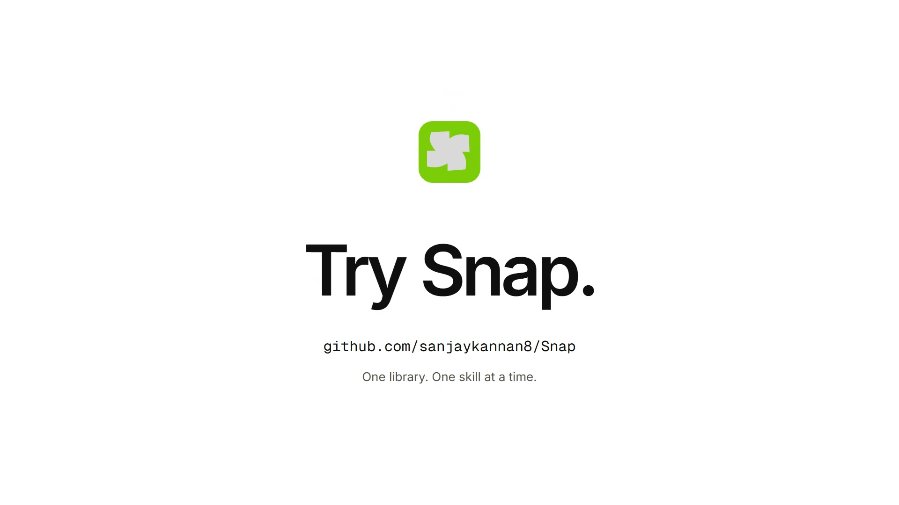

# Snap

One skill library for all your AI agents, with on-demand skill discovery.

[](LICENSE)

[](docs/media/snap-launch.mp4)

[Watch the launch video](docs/media/snap-launch.mp4) · [Music and sound credits](docs/media/CREDITS.md)

**Current limits:** 64 skills in the dashboard; each skill is a single `SKILL.md`. Associated scripts, assets and multi-file packages are not bundled.

## Quick start

Requires Git and a running Docker installation with Compose. No host Node.js or Python install is needed. These are the three shell commands; **after copying `.env`, configure the model and replace `JWT_SECRET` before starting the stack**. The first image build downloads dependencies and can take several minutes.

```bash
git clone https://github.com/sanjaykannan8/Snap.git && cd Snap
cp -n .env.example .env
# Edit .env as described below before running the third command.
docker compose up -d --build
```

<details>
<summary>Windows PowerShell commands</summary>

```powershell
git clone https://github.com/sanjaykannan8/Snap.git; if ($LASTEXITCODE -eq 0) { Set-Location Snap }
if (!(Test-Path .env)) { Copy-Item .env.example .env }
# Edit .env as described below before running the third command.
docker compose up -d --build
```

</details>

If already cloned, enter your existing Snap directory instead of cloning again. Keep an existing `.env` and edit its settings. Install [Docker Desktop](https://docs.docker.com/desktop/) on Windows/macOS, or [Docker Engine with Compose](https://docs.docker.com/engine/install/) on Linux. Check `docker info` if the daemon is unavailable.

### Configure the model

Open `.env` in your editor. Replace `JWT_SECRET` with a random secret, then choose one routing provider:

```env
# Cloudflare Workers AI
ROUTING_PROVIDER=cloudflare
CLOUDFLARE_ACCOUNT_ID=YOUR_ACCOUNT_ID
CLOUDFLARE_API_TOKEN=YOUR_WORKERS_AI_TOKEN
```

Or point Snap at an **already running** System One-compatible model server:

```env
ROUTING_PROVIDER=local
LOCAL_SYSTEMONE_URL=http://YOUR_MODEL_HOST:30000/v1/systemone
LOCAL_SYSTEMONE_MODEL=Cloudflare/clef-flash
LOCAL_SYSTEMONE_API_KEY=YOUR_MODEL_SERVER_KEY
```

Use `host.docker.internal` for a model on the Docker host, or a reachable hostname/IP for another machine. Set the model name and key to those expected by your endpoint; the key can be blank for a server without authentication. Snap does not install the model server.

<details>
<summary>Generate a JWT secret on Linux/macOS</summary>

```bash
openssl rand -hex 32
```

Paste the result into `JWT_SECRET` in `.env`.

</details>

<details>
<summary>Generate a JWT secret in Windows PowerShell</summary>

```powershell
$snapBytes = New-Object byte[] 32
[Security.Cryptography.RandomNumberGenerator]::Create().GetBytes($snapBytes)
-join ($snapBytes | ForEach-Object { $_.ToString('x2') })
```

Paste the result into `JWT_SECRET` in `.env`.

</details>

After startup, open [localhost:3000](http://localhost:3000), create an account, publish a `SKILL.md`, and generate a key under **Connections**. Copy the displayed configuration into your agent. The `init` container should exit successfully; `web`, `mcp`, `dynamodb` and `minio` should stay running. Check with `docker compose ps -a`.

## Why Snap

- **Publish once, use across agents.** Maintain one central library and connect MCP clients to it.
- **Load skills on demand.** Snap returns at most one matched skill per call, without preloading the whole library into the agent.
- **Choose your decision endpoint.** Use Cloudflare Workers AI or a System One-compatible server. The endpoint receives the task and skill names/descriptions.

A **decision model** returns probabilities for typed choices instead of generating text. Snap defaults to Clef-flash; its System One `state`/`questions` interface is compatible with [TypeSafe's Jev API](https://docs.typesafe.ai/introduction/quickstart), with the model identifier configured for your endpoint.

## How it works

1. Publish a `SKILL.md` with a name and description.
2. Connect your agent through MCP using its generated `X-Snap-API-Key` header.
3. The agent calls `get_skill` with a task; Snap scores the library metadata and returns a skill when the confidence clears `SKILL_MATCH_THRESHOLD` (default `0.42`). Otherwise it returns no match.

### Example `get_skill` call

Input through your MCP client:

```json
{
  "name": "get_skill",
  "arguments": {
    "problem": "Extract the invoice line items from this scanned PDF into a table."
  }
}
```

Illustrative decoded tool response for an object-backed skill (confidence is the model's score, not a guarantee):

```json
{
  "name": "pdf-extract",
  "description": "Extract text, tables and form fields from PDF files, including scanned PDFs that need OCR.",
  "confidence": 0.97,
  "content": "---\nname: pdf-extract\n---\nUse pdfplumber for text and tables. Fall back to OCR for scanned pages.",
  "url": "https://storage.example/snap-skills/pdf-extract/SKILL.md?X-Amz-Signature=...",
  "expiresInSeconds": 300
}
```

No match returns `No matching skill found.` See [network and response details](docs/network.md#skill-content-and-signed-downloads) for content handling and download URLs.

## Mini benchmark

Measured on **2026-11-01**, using live `Cloudflare/clef-flash` inference through a LAN System One endpoint, local DynamoDB and MinIO, and authenticated HTTP MCP calls:

| Library size | In-scope top-1 match | Correct no-match | End-to-end p50 | End-to-end p95 |
| ---: | ---: | ---: | ---: | ---: |
| 10 | 16/16 (100%) | 8/8 (100%) | 372 ms | 583 ms |
| 30 | 16/16 (100%) | 8/8 (100%) | 495 ms | 612 ms |
| 64 | 16/16 (100%) | 6/8 (75%) | 553 ms | 713 ms |

Small synthetic smoke test: eight in-scope and four out-of-scope prompts, each run twice per size (72 measured calls), with one excluded warm-up per size and threshold `0.42`. Timing includes authentication, catalog lookup, model inference, matched skill retrieval, signing and the MCP response; it excludes agent reasoning and a separate download. No request errors occurred. These fixtures do not establish production accuracy or a universal latency target. [Method, fixtures, raw results and reproduction](docs/benchmarks/README.md).

## Snap vs native skills

**Native skills:** a simpler choice for one agent with a small local library, especially when you need bundled scripts/assets or existing client-specific workflows.

**Snap:** useful when several agents should share one centrally managed library and retrieve a single matched skill through MCP. It adds a service, storage and an inference dependency.

## Connect your agent

**Connections** generates setup for Claude Code, Codex, Cursor and VS Code. Copy the new key before dismissing the panel; it is shown once. [Client configuration examples, including OpenCode](docs/agent-clients.md).

## Skill format

```markdown
---
name: api-review
description: Review API endpoints for consistency and error handling.
---

# API review
Check request validation, response shapes, and error handling.
```

## Troubleshooting

| Symptom | What to check |
| --- | --- |
| `init` does not finish, or `web`/`mcp` are waiting | Run `docker compose logs init dynamodb minio`. Check that database/storage are running and storage credentials agree. After fixing the cause, rerun `docker compose up -d --build`. An `init` exit code of 0 is expected. |
| A remote agent receives a URL containing `127.0.0.1` | Follow the [storage-address fix](docs/network.md#skill-content-and-signed-downloads), then request the skill again. |
| MCP returns `401` | Send `X-Snap-API-Key` on every MCP request. Use the full generated key, not a dashboard login token; generate a new key if the old one was revoked. |
| Routing is unavailable | Check `docker compose logs mcp`, provider credentials, the complete model endpoint, and whether the model host is reachable from inside Docker. |

## More documentation

- [Expose Snap on your network](docs/network.md)
- [Frontend development](docs/development.md)
- [Configuration reference](docs/configuration.md)
- [Backend and deployment](docs/backend.md)

Stop the local stack with `docker compose down`; named data volumes are preserved.

## Security and limitations

MCP keys are account-scoped and stored as SHA-256 hashes. The dashboard uses signed JWTs in `HttpOnly`, `SameSite=Lax` cookies. Keep keys and `.env` files private; use HTTPS and `SESSION_COOKIE_SECURE=true` for internet-facing deployments. Only publish and apply skill instructions you trust.

- The dashboard caps the library at 64 single-file skills; multi-file packages are not supported.
- No explicit “none applies” model option exists yet. The confidence threshold can return false matches, as the benchmark demonstrates.
- Context use depends on the client, library and frequency of calls. Retrieved content and history still accumulate; no general break-even point or constant total-session context has been established.
- Automatic fallback to the larger Clef model and an R2 deployment are not implemented.

## Contributing

Run `npm run lint` for frontend changes and `uv run pytest` from `mcp-service` for MCP changes. The [live benchmark](docs/benchmarks/README.md) is opt-in and requires a model endpoint.

## License

[MIT](LICENSE) © 2026 Kannan K
