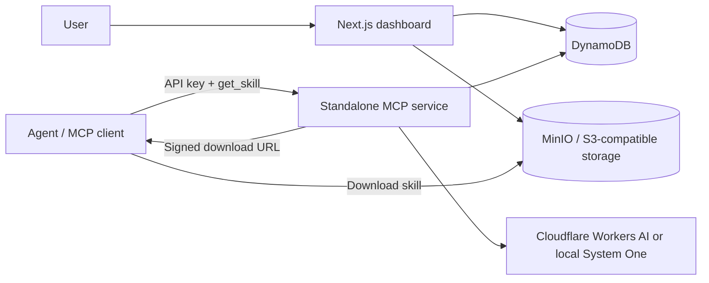

# Snap

One skill library for all your AI agents, with on-demand skill discovery.

[](LICENSE)

<!-- TODO: add 60-90s demo GIF -->

## Why Snap

- **Publish once, use in every agent.** Keep your skills in one library and connect MCP clients to it.
- **Keep skill context focused.** Native skill metadata can grow with a library; Snap returns at most one matched skill per call. No general break-even point has been established.
- **Choose the decision model endpoint.** Use Cloudflare Workers AI or a locally hosted System One-compatible endpoint. The selected endpoint receives the task and skill names and descriptions.

## How it works

1. Publish a `SKILL.md` through the dashboard and create an API key for your agent.
2. Connect an MCP client to the standalone service using the `X-Snap-API-Key` header.
3. The agent calls `get_skill` with a short description of its task.
4. Snap loads that user's skill metadata from DynamoDB and asks the configured decision model endpoint to select a match.
5. If the match meets the confidence threshold, Snap returns a five-minute signed URL to the skill file. Otherwise, the agent continues without one.

Clef-flash is Cloudflare's 9B open-weight decision model: it returns probabilities for typed questions rather than generating text. Snap uses it by default; Clef is configurable. Older skills stored directly in DynamoDB are returned inline instead of by URL.



## Quickstart

Choose **one** of the following local workflows. Both expose the dashboard at [localhost:3000](http://localhost:3000) and the MCP endpoint at `http://127.0.0.1:3100/mcp`. Docker Desktop (or Docker Engine with Compose) must be running. Routing can use Cloudflare Workers AI or a local System One-compatible endpoint; configure one as described below.

### Option 1: Run everything with Docker Compose

Copy `.env.example` to `.env`, then set `JWT_SECRET` and your chosen routing provider's settings in `.env`. For example, in PowerShell:

```powershell
Copy-Item .env.example .env
```

Start the full stack:

```bash
docker compose up --build
```

Compose builds the Next.js frontend and standalone Python MCP images, starts DynamoDB Local and MinIO, and initializes the table and bucket. Leave it running, then open [localhost:3000](http://localhost:3000). The first build needs network access. Stop the stack with `docker compose down`; named volumes are retained.

### Option 2: Run the frontend locally, then start the MCP stack with Docker

This is useful for frontend development. It requires Node.js 22+ and npm in addition to Docker; Python and uv are not required on the host. These commands use PowerShell.

1. Copy the example configuration for Next.js and Compose:

```powershell
Copy-Item .env.example .env.local
Copy-Item .env.example .env
```

2. Set a strong `JWT_SECRET` in `.env.local`. Configure the same routing provider in `.env.local` and `.env` (Compose reads `.env`; Next.js reads `.env.local`). Leave the example local database, storage, and MCP URLs unchanged unless you have configured alternatives.

3. In the first terminal, install dependencies and start the frontend:

```powershell
npm ci
npm run dev
```

4. In a second terminal at the repository root, start the MCP service and its dependencies:

```powershell
docker compose up -d --build mcp
```

Compose builds the Python MCP image and an initialization image, starts DynamoDB Local and MinIO, and creates the required table and bucket. It does not start the Dockerized web service, so the local frontend can use port 3000. The frontend may show connection errors until initialization completes. Check `docker compose ps` and `docker compose logs mcp` if needed; stop the containers with `docker compose down` when finished.

For either option, open the dashboard, create an account, add a skill, and generate a connection key. In **Connections**, copy the setup for your agent; it uses `X-Snap-API-Key` for authentication. Localhost URLs work only from the same machine. For remote hosting, configure HTTPS and public MCP and storage URLs as described in [deployment notes](docs/backend.md).

### Choose a routing provider

Set these server-side variables in `.env` for Compose, and in `.env.local` as well when running Next.js locally:

- Cloudflare: `ROUTING_PROVIDER=cloudflare`, `CLOUDFLARE_ACCOUNT_ID`, `CLOUDFLARE_API_TOKEN`, and optionally `CLOUDFLARE_CLEF_MODEL`.
- Local: `ROUTING_PROVIDER=local`, `LOCAL_SYSTEMONE_URL` (the complete URL ending in `/v1/systemone`), `LOCAL_SYSTEMONE_MODEL`, and optionally `LOCAL_SYSTEMONE_API_KEY`. The endpoint must implement the System One request and response format; this does not start a model server.

For a model server running on the Docker host, use `http://host.docker.internal:30000/v1/systemone` in Compose. A Next.js process running directly on the host may instead need `http://127.0.0.1:30000/v1/systemone`. A model on another machine needs that machine's reachable address. Restart the services after changing these settings. Do not use a real key with an untrusted endpoint.

### Allow agents on your network

Compose binds to localhost by default. To make MCP and signed MinIO downloads reachable from another device, set `MCP_BIND_ADDRESS=0.0.0.0` and `S3_BIND_ADDRESS=0.0.0.0` in `.env`; set `S3_PUBLIC_ENDPOINT` to the reachable object-storage URL. When the dashboard is opened through the server's network address, it uses that address for the default MCP URL. Set `MCP_PUBLIC_URL` explicitly when the MCP service uses a different public address or HTTPS proxy. For example, on a trusted LAN, the URLs can use your server's LAN IP and ports 3100 and 9000. Set `WEB_BIND_ADDRESS=0.0.0.0` only if the dashboard also needs network access. If Next.js runs outside Compose, set `MCP_BIND_ADDRESS=0.0.0.0` in `.env.local` as well. DynamoDB and the MinIO console remain localhost-bound. Restart services after changing the settings.

For access beyond a trusted local network, place the dashboard, MCP service, and object storage behind HTTPS and configure firewall rules and strong credentials. Clients must be able to reach the exact `S3_PUBLIC_ENDPOINT` used in the signed URL; it must not be `127.0.0.1` for an agent on another machine. Browser clients also need their origin in `MCP_ALLOWED_ORIGINS`.

The Compose example defaults to `SESSION_COOKIE_SECURE=false` so login works over local HTTP, including a LAN IP. When serving the dashboard over HTTPS, set `SESSION_COOKIE_SECURE=true`. If a reverse proxy changes the host or terminates TLS, set `APP_ORIGIN` to the exact browser-facing dashboard origin, for example `https://snap.example.com` (no path or trailing slash). Without it, Snap checks the request's Host and protocol. Configure your proxy to reject unexpected hosts and strip untrusted forwarded headers. A browser client that sends an Origin to MCP must separately be included in `MCP_ALLOWED_ORIGINS`; a non-browser MCP client can omit Origin.

## Connect your agent

The dashboard's connection panel produces these configurations with your endpoint and new key. A key is shown once; copy it before dismissing the panel. Keep populated configurations private and merge entries into existing settings instead of overwriting them.

**Claude Code** — add to your project's `.mcp.json` (do not commit a file containing your key):

```json
{
  "mcpServers": {
    "snap": {
      "type": "http",
      "url": "http://127.0.0.1:3100/mcp",
      "headers": { "X-Snap-API-Key": "YOUR_API_KEY" }
    }
  }
}
```

**Codex** — add to `~/.codex/config.toml`:

```toml
[mcp_servers.snap]
url = "http://127.0.0.1:3100/mcp"
http_headers = { "X-Snap-API-Key" = "YOUR_API_KEY" }
```

**Cursor** — add to your personal `~/.cursor/mcp.json`:

```json
{
  "mcpServers": {
    "snap": {
      "url": "http://127.0.0.1:3100/mcp",
      "headers": { "X-Snap-API-Key": "YOUR_API_KEY" }
    }
  }
}
```

**VS Code** — use **MCP: Open User Configuration** and add:

```json
{
  "servers": {
    "snap": {
      "type": "http",
      "url": "http://127.0.0.1:3100/mcp",
      "headers": { "X-Snap-API-Key": "YOUR_API_KEY" }
    }
  }
}
```

Restart the client or start a new session after saving. The agent decides when to call the tool; a useful instruction for its configuration is: “At the start of a substantive task, call `get_skill` with a short description of the task. Read the returned skill if there is a match.”

## Skill format

Snap currently accepts one `SKILL.md` file with `name` and `description` frontmatter:

```markdown
---
name: api-review
description: Review API endpoints for consistency and error handling.
---

# API review

Check request validation, response shapes, and error handling.
```

## Configuration

Use `.env.local` for the dashboard and `mcp-service/.env` for the Python service. See the example files for local defaults.

| Variable | Purpose |
| --- | --- |
| `DYNAMODB_ENDPOINT` | Local DynamoDB endpoint; omit for AWS DynamoDB. |
| `DYNAMODB_REGION`, `DYNAMODB_TABLE` | Shared DynamoDB region and table. |
| `S3_ENDPOINT` | Object-storage endpoint used for uploads and reads. |
| `S3_PUBLIC_ENDPOINT` | Endpoint used to sign URLs; it must be reachable by the agent. |
| `S3_REGION`, `S3_BUCKET` | Object-storage region and shared bucket. |
| `S3_ACCESS_KEY`, `S3_SECRET_KEY` | Server-side object-storage credentials. |
| `JWT_SECRET` | Dashboard session signing secret. |
| `SESSION_COOKIE_SECURE` | `false` for local HTTP; set `true` for HTTPS. Outside Compose, defaults to true in production. |
| `APP_ORIGIN` | Optional exact browser-facing dashboard origin for reverse-proxy deployments. |
| `CLOUDFLARE_ACCOUNT_ID`, `CLOUDFLARE_API_TOKEN` | Workers AI credentials for the MCP service; also needed by the web app's routing API if used. |
| `CLOUDFLARE_CLEF_MODEL` | Clef model identifier; defaults to `@cf/cloudflare/clef-flash`. |
| `ROUTING_PROVIDER` | `cloudflare` (default) or `local`. |
| `LOCAL_SYSTEMONE_URL`, `LOCAL_SYSTEMONE_MODEL`, `LOCAL_SYSTEMONE_API_KEY` | Local System One endpoint, model name, and optional bearer token. |
| `WEB_BIND_ADDRESS`, `MCP_BIND_ADDRESS`, `S3_BIND_ADDRESS` | Compose host bind addresses; default to `127.0.0.1`. |
| `SKILL_MATCH_THRESHOLD` | Minimum confidence for a match; defaults to `0.42`. |
| `MCP_HOST`, `MCP_PORT` | Address and port for the MCP service. |
| `MCP_ALLOWED_ORIGINS` | Comma-separated browser Origin allowlist; clients without an Origin header can omit it. |
| `MCP_PUBLIC_URL` | Full MCP URL displayed by the dashboard. |

## Security model

The dashboard uses signed JWTs in `HttpOnly`, `SameSite=Lax` cookies. Set `SESSION_COOKIE_SECURE=true` for HTTPS; Compose defaults to false for local HTTP. MCP keys are account-scoped; Snap stores their SHA-256 hashes and checks them on requests. Skill download URLs expire after five minutes. Revoking a key prevents later MCP calls, but does not invalidate URLs already issued.

Skills contain instructions consumed by agents. Only publish and use skills you trust, and review them before applying their instructions.

## Limitations and roadmap

- Skills are single files; associated scripts and assets are not bundled.
- New skills are delivered by signed URL; direct inline delivery for new files is a possible future improvement. Legacy DynamoDB-only skills are already returned inline.
- The current choice compares skills without an explicit “no skill applies” option. A confidence threshold is a weak no-match signal; an explicit option is a possible improvement.
- Automatic fallback to larger Clef and an R2 deployment are not implemented.
- The dashboard uses a 64-skill capacity. Clef's limits on options within a single choice need verification before promising larger libraries.
- Context savings depend on the client, skill library, and frequency of calls; they have not been established across real deployments.

## When NOT to use Snap

If you use one agent with a handful of skills and native skill loading already works for you, the extra service and storage may not be worthwhile.

## Deployment

Build `mcp-service/Dockerfile` from the `mcp-service` directory and run replicas behind HTTPS. Set `MCP_PUBLIC_URL` for the dashboard and make both the MCP endpoint and signed object-storage URL reachable by remote agents. Configure shared DynamoDB, storage, and secrets on each replica. See [docs/backend.md](docs/backend.md) for details.

## Contributing

Run the checks relevant to your change:

```powershell
npm run lint
cd mcp-service
uv run pytest
```

## License

[MIT](LICENSE) © 2026 Kannan K
